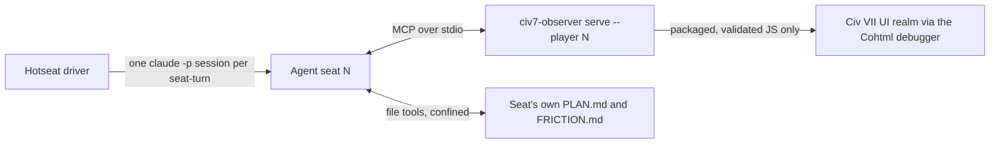

# civ7-agents

[](../../actions/workflows/tests.yml)

MCP servers that let AI agents play **Civilization VII** as ordinary players. Each agent controls
one seat through the game's own rules, sees only what that seat can see, and can take only the
actions the game would offer that seat.

A hobby project, and a work in progress. It is also an experiment in agentic software development:
Claude Code writes it, Codex reviews it adversarially, and Claude agents playing the game are the
main way it gets tested live.

## What it has done

In an all-agent, four-seat hotseat game, each seat-turn was played by a separate, isolated Claude
Code session connected to an MCP server bound to that seat. Totals, from
[the performance report](civ7-observer/docs/stage-1-performance-report.md), which is generated from
the driver's logs:

- **787 seat-turns** played and **216 complete rounds**, through turn 132 and into the Exploration
  Age, over about 21 hours of wall-clock time.
- About **60 s and $0.50 per seat-turn** for the latest setup (Sonnet, low effort), with roughly
  20 confirmed game actions per turn.
- **125 native action kinds** in the catalog: research, production, units, combat, diplomacy,
  religion, Age transitions and more. **52** have a confirmed receipt from a real game. The rest are
  offline-verified only, and [the coverage report](civ7-observer/docs/action-coverage.md) says which
  are which.

For what a turn looks like from the agent's side, see
**[one complete agent turn](civ7-observer/docs/examples/agent-turn-t129-seat0.md)**: the tool
calls, the agent's reasoning, the host's receipts, and the
[62 KB system prompt](civ7-observer/docs/examples/agent-turn-t129-seat0.system.md) assembled for it.

## How it works



- **Seat-bound.** The game's debug API is omniscient: from one seat it will report every player's
  state. The server refuses to run unless the bound seat is both the local player and the local
  observer. It exports only currently visible tiles. A tests-enforced policy scans every script
  sent to the game and rejects references to any other player.
- **Offered ids only.** The agent never writes game code or engine arguments. It gets a compact
  turn brief and opaque action ids for this turn, and calls `perform_action(id, request_id)`. The
  host checks that the game allows the action, reserves it durably, sends it, and confirms it by
  reading the game state back. An ambiguous outcome is recorded as `unknown` and is never retried.
- **Isolated seats.** Each seat session has its MCP server and file tools confined to its own
  directory: no shell, no network, no subagents. It keeps its own long-term plan, routed strategy
  "skill cards" are injected into its prompt, and it reports missing tools or information as
  friction, which becomes the backlog.

More detail: [civ7-observer/README.md](civ7-observer/README.md) for usage,
[STATUS.md](civ7-observer/STATUS.md) for what works, what doesn't and what is unverified, and
[docs/agent-runner.md](civ7-observer/docs/agent-runner.md) for the agent harness.

## How it is built

The workflow is part of what's on show here:

- **Claude Code plans and builds** ([CLAUDE.md](CLAUDE.md)). Every non-trivial change starts as a
  written plan with acceptance criteria. Each criterion says which kind of evidence will close it:
  an offline test, a live receipt, or a recorded observation.
- **Codex reviews adversarially and does not author** ([CODEX.md](CODEX.md)). It reviews the plan
  before code is written, then the code against the plan, and returns numbered, prioritised findings
  with reproductions. The fixes land as their own commits, which you can see in the history:
  `Address steps 2 and 3 review: …`, `Review R1-R4: event baselines, identity-only purchase proofs, …`.
- **A human operator** runs the game, decides, and merges.

Plans and reviews are working documents and are kept out of the repository. What survives is the
code, the tests, `STATUS.md`, the evidence docs and the commit history.

### Testing a live game with agents

Because of what this project is, most real verification cannot be a fast automated suite. The game
has no headless mode and no way to stage a scenario, and most actions only become available after
dozens of turns of real play. So testing has two tiers:

- **Offline** (pytest with a fake debugger, plus Node tests that run the real game scripts against
  mocked game globals: about 800 tests, run in CI) proves the host's own logic. It cannot prove what
  the engine does.
- **Live**: agents play the game, and a test ledger adds a few "testing opportunities" to each
  seat's prompt for action kinds that seat can take right now but that have not been verified yet.
  An action kind counts as verified only by a confirmed receipt stamped with the current digest of
  the code that implements it. Changing that code turns earlier passes into `retest`. What an agent
  says it did is never evidence.

This approach is slow, costs money and isn't reproducible turn for turn, so the docs keep
"implemented", "offline-verified" and "live-verified" separate everywhere.

## Repository layout

| path | what | state |
|---|---|---|
| [`civ7-observer/`](civ7-observer/) | v1, Python: seat-bound observation, the action catalog, the MCP server, and the agent-vs-agent hotseat driver | working; development stopped 2026-09-17 |
| [`civ7-plugin/`](civ7-plugin/) | v2, Node/TypeScript: a game-owned mod plus a thin MCP bridge, so play won't need the debugger | Step 0 experiments; [results](civ7-plugin/docs/step-0-results.md) include finding that the game's WebSocket is a stub |

## Quick start (v1, Linux)

```bash
python3 -m venv .venv
.venv/bin/pip install -e 'civ7-observer[test]'
civ7-observer/run-tests.sh                      # offline suites, no game needed

# with the game running and its UI debugger enabled (see civ7-observer/README.md):
.venv/bin/python -m civ7_observer doctor
.venv/bin/python -m civ7_observer serve --player 0 --mode singleplayer           # read-only tools
.venv/bin/python -m civ7_observer serve --player 0 --mode singleplayer --allow-actions
```

> **Caution:** with `--allow-actions` the server changes a running game. On the tested build the
> game's debugger listens on `0.0.0.0:9444`, so firewall that port on any shared network.

## License and disclaimer

MIT, see [LICENSE](LICENSE). This is an unofficial fan project. It is not affiliated with or
endorsed by Firaxis Games or 2K. Civilization is a trademark of Take-Two Interactive Software, Inc.
No game files are included.
